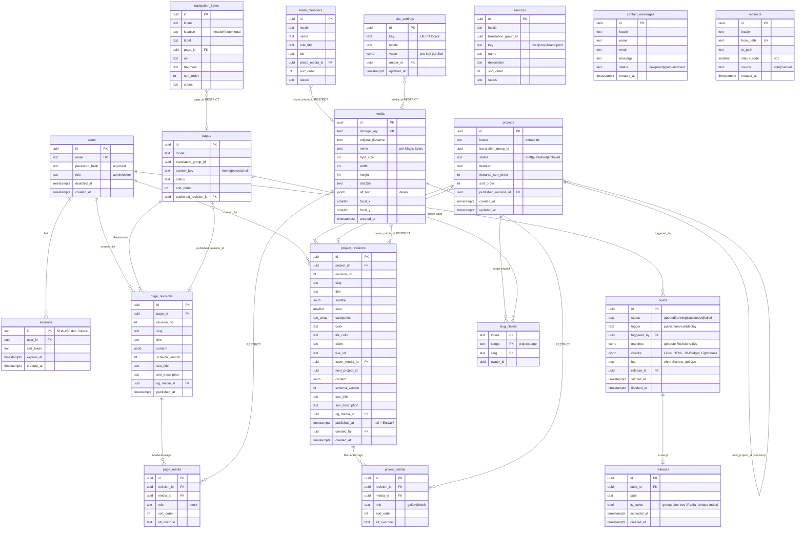

# serendCMS · Analyse der Design-Vorlage (Schritt 1, Freigabe ausstehend)

Quelle: `design/DESIGN-SPEC.md`, `design/tokens.css`, `design/prototype/{start,projekte,detail}.html`, `design/images/README.md`.
Nicht ausgewertet: die PNG-Screenshots (Phase 3, Abnahme). Bei Widersprüchen gilt laut Spec der Prototyp.
**Es ist nichts implementiert.** Dieses Dokument ist die Grundlage für deine Freigabe.

---

## 0. Entscheidungen, die ich von dir brauche

Zu jedem Punkt steht mein Vorschlag. Antwortest du „freigegeben“, gelten die Vorschläge.

| # | Befund | Vorschlag |
|---|---|---|
| 1 | **Zweisprachigkeit.** Der Brief sagt „zunächst einsprachig“. Das Design verlangt DE und EN von Anfang an (`/de/…`, `/en/…`, Umschalter, alle Texte in beiden Sprachen). | Eine Sprachversion ist ein eigener Datensatz (stabile Zeile plus Revisionen, `locale` in der Zeile). Die Sprachversionen sind über `translation_group_id` verknüpft. Daraus entstehen Sprachumschalter und `hreflang`. Seeds enthalten DE und EN. Sprachneutrale Felder (Jahr, Farbe, Kategorien, Bilder) stehen in beiden Revisionen. Der Admin hat dafür die Aktion „Sprachversion anlegen (kopiert)“. Das Risiko ist Auseinanderlaufen. Alternative wäre eine zusätzliche Gruppentabelle mit den neutralen Feldern. Das wäre sauberer, aber komplexer und weicht vom Brief ab. |
| 2 | **Kein Kontaktformular im Design.** Es gibt nur `mailto:hallo@serend.design` und den CTA „Projekt anfragen“ (Anker `#kontakt`). Im Brief stehen aber Kontaktformular, `contact_messages`, Honeypot und Rate-Limit. | Ich baue Endpunkt, Tabelle, Spam-Schutz und Tests (Phase 5). Das Formular selbst rendere ich erst, wenn du mir Texte (Labels, Einwilligung, Bestätigung) und eine Gestaltungsfreigabe gibst. Sonst müsste ich Texte erfinden, und das verbietet die Spec. Bis dahin bleibt es bei der E-Mail-Adresse. |
| 3 | **Kein Team im Design.** Der Brief nennt `team_members`, im Design gibt es aber nur das Studio-Porträt. | Die Tabelle und der Admin-CRUD kommen in Phase 5. Im Frontend wird nichts gerendert, bis es ein Design gibt. |
| 4 | **JS-Budget (50 KB pro Seite) gegen die Design-Empfehlungen.** Die Spec empfiehlt Framer Motion und Lenis. Der Brief verbietet weitere Libraries und setzt ein Budget. Ein React-Island für den Konfigurator liefert `react-dom` mit (ca. 45–60 KB gzip) und sprengt das Budget. | **Kein** Framer Motion und **kein** Lenis. Alles läuft mit CSS (Vorhang, Masken-Reveal, scroll-driven Animations wie im Prototyp). Dazu kommt Vanilla-JS (~2 KB) für Filter, Raster/Liste, Theme und Vorhang beim Verlassen der Seite. Der Konfigurator wird ein Island mit `client:visible`. Für das Budget brauche ich deine Wahl: **(a)** Preact über `@astrojs/preact` für Islands (ca. 4 KB, Komponenten bleiben TSX; neue Pakete, brauchen deine Freigabe), **(b)** React belassen und das Budget nur für den initialen Load messen, Islands separat mit Limit, **(c)** Konfigurator in Vanilla-TS. Meine Empfehlung ist (a). Außerdem: gzip oder roh? Ich nehme gzip. |
| 5 | **Footer inkonsistent.** Startseite: dreispaltiger Footer. Projekte: schmale Mono-Zeile. Detail: gar keiner. Impressum und Datenschutz wären dann nicht von jeder Seite erreichbar (Impressumspflicht). | Der dreispaltige Footer (Spec 3.6) erscheint auf allen Seiten. Das ist eine bewusste Abweichung vom Prototyp. |
| 6 | **Google Fonts** in `tokens.css` (externer Request, DSGVO-kritisch, bremst Lighthouse, CSP-Eintrag nötig). | Plus Jakarta Sans, Inter und Geist Mono werden als WOFF2 (OFL) im Repo gehostet und per `@font-face` mit `font-display: swap` und Preload eingebunden. Die CSP bleibt dadurch `'self'`. |
| 7 | **Projektfarbe zweideutig.** Die Startseite nutzt andere Hover-Farben als `images/README.md`. Beispiel Cista: `#412812` statt `#d9b66d`, Dolce & Falcone: `#303030` statt `#66a903`. Der Grund ist vermutlich der Kontrast zum weißen „Ansehen“-Text. | Zwei Felder: `color` (README, Liste, Bildhintergrund) und optional `tile_color` (Hover-Kreis der Startseite, Fallback `color`). Seeds übernehmen die Prototyp-Werte. |
| 8 | **Erweiterungen am Datenmodell** gegenüber der Brief-Liste (Details in Abschnitt 3 und 5): typisierte Spalten an `project_revisions` (Jahr, Kategorien, Farbe, Kunde, Live-URL, Untertitel, Cover, `next_project_id`), `featured_sort_order`, `translation_group_id`, `pages.system_key`, `media.focal_x/y`, `media.alt_text` als Sprach-Map, Tabelle `slug_claims`. | Freigabe der Erweiterungen. |
| 9 | **Paketliste** (Abschnitt 8). Der Brief verlangt Rückfrage für alles Zusätzliche. | Freigabe oder Streichungen. |
| 10 | **Rollen:** darf `editor` veröffentlichen? | Ja. Editor darf Inhalte anlegen, ändern, veröffentlichen und archivieren. Nur admin darf Benutzer, Einstellungen, Rollback und hartes Löschen. Matrix in Abschnitt 6. |

Hinweis zur Seed-Basis: Nur **Dolce & Falcone** hat im Design Detailinhalte (Kapitel, Zitat, Demo, Bildstrecke). Die anderen 11 Projekte haben nur Name, Jahr, Kategorien, Farbe und Cover. Die Seeds legen sie veröffentlicht mit diesen Feldern und ohne Blöcke an. Die Detailseite rendert dann nur Hero und Cover. Ich erfinde keine Texte.

---

## 1. Seitentypen und Routen

| Typ | Route DE / EN | Inhalt | Daten |
|---|---|---|---|
| **Startseite** (`home`) | `/de/` · `/en/` | 5 Sektionen, siehe 2.2 | Seite mit Blöcken plus berechnete Daten |
| **Projektübersicht** (`project_index`) | `/de/projekte/` · `/en/work/` | Titel, Filterleiste, Raster/Liste | Seite plus alle veröffentlichten Projekte |
| **Projektdetail** (`project`) | `/de/projekte/<slug>` · `/en/work/<slug>` | Hero, Bildstrecke, Kapitel, Zitat, Demo, Nächstes Projekt | Projekt-Revision |
| **Inhaltsseite** (`content`) | `/de/<slug>` · `/en/<slug>` | Impressum, Datenschutz, später Philosophie/Studio | Seite mit Blöcken |
| Technisch | `/` (Sprachweiche), `/404.html`, Preview-Subdomain | Weiche per Caddy (Accept-Language, Cookie) | Konfiguration |

Der Routen-Segmentname („projekte“ vs. „work“) kommt aus dem Slug der Seite mit `system_key = 'projects'` je Sprache. Die Projekt-URL ist `/<locale>/<slug-der-Projektübersicht>/<projekt-slug>`.

**Nicht im Design, aber nötig** (ich baue sie minimal aus vorhandenen Bausteinen, bitte bestätigen): Inhaltsseiten (Impressum/Datenschutz verlinken im Prototyp nur auf `#kontakt`), 404-Seite, Sprachweiche.

---

## 2. Wiederkehrende Sektionen und Bausteine

### 2.1 Global (Layout, nicht im CMS-Inhalt)

| Baustein | Quelle der Inhalte |
|---|---|
| **Header** (Wortmarke, Hauptnavigation, DE/EN-Umschalter, Theme-Knopf, CTA mit Statuspunkt, Mobile-Overlay) | Navigation: `navigation_items`. CTA-Label und -Ziel: `site_settings`. UI-Texte: Wörterbuch im Code. |
| **Seitenübergang** (5-Streifen-Vorhang) | Nur CSS plus ~1 KB JS fürs Schließen beim Verlassen |
| **Scroll-Fortschritt** (Liquid, 3 px) | CSS (`animation-timeline`), Fallback minimal |
| **Footer** (Studio / Navigation / Rechtliches, Mono-Zeile) | `site_settings` (Name, Stadt, E-Mail, „Gemacht mit Hingabe…“), `navigation_items` (Navigation und Rechtliches) |
| Reveal, Masken-Reveal, **LiquidText**, **BigLink**, Eyebrow, Statuspunkt | Komponenten, keine Inhalte |
| Theme (Inline-Script gegen Aufblitzen) | `localStorage`, kein Backend |

**UI-Texte** (Aria-Labels, „Ansehen“, „Raster/Liste“, Filterlabels, Konfigurator-Chrome) bleiben ein typisiertes Wörterbuch `de.ts`/`en.ts` im Code. Die Prototypen sind ein `T`-Objekt, das 1:1 übernommen werden soll. **Redaktionelle Texte** liegen im CMS.

### 2.2 Sektionen je Seite

| Seite | Sektion | Blocktyp | Datenquelle |
|---|---|---|---|
| Start | Hero (Eyebrow, 2–3 Headline-Zeilen mit Liquid-Wort, Intro, BigLink) | `hero` | Block |
| Start | Ausgewählte Arbeiten (Bento 2×2, 1×2, 3×1×1; „05 / 12“; „2023 — 2026“) | `featured_projects` | Projekte (`featured`, `featured_sort_order`); Zähler und Jahresspanne berechnet |
| Start | Leistungen (4 Zeilen) | `services_overview` | Tabelle `services` |
| Start | Präambel-Karte (Porträt, Badge, Überschrift, Text, BigLink) | `media_text_card` | Block plus Medium |
| Start | Kontakt (große Zeile, E-Mail als Liquid) | `contact_cta` | Block; E-Mail aus `site_settings` |
| Projekte | Titel „Arbeiten (12)“ plus Intro | `page_title` | Block; Anzahl berechnet |
| Projekte | Filter-Tabs mit Zahlen, Zähler, Raster/Liste, Kacheln/Zeilen | `project_index` | Projekte; Tab-Namen aus `services` |
| Detail | Hero (Case-Label „Case 01 / 12 · E-Commerce“, Titel mit Masken-Reveal, Untertitel mit Liquid-Wort, Meta-Tabelle) | Vorlage, kein Block | Spalten der Revision |
| Detail | Bildstrecke (Scroll-Snap) | Vorlage | `project_media` (Rolle `gallery`) |
| Detail | Kapitel (Lead und Text, sticky Kapitel-Navigation mit Fortschrittsschiene) | `chapter` | Block |
| Detail | Zitat zwischen zwei Linien | `quote` | Block |
| Detail | Interaktive Demo (Pick&Mix) | `interactive_demo` | Block |
| Detail | Nächstes Projekt (Panel, Vorschaubild) | Vorlage | `next_project_id` oder berechnet |
| Inhaltsseite | Titel, Überschriften, Fließtext | `page_title`, `heading`, `richtext` | Block (ohne Design-Vorlage, Typografie vom Kapitelartikel abgeleitet) |

Berechnete Werte:
- „Case 01 / 12“: Position nach `sort_order` unter allen veröffentlichten Projekten der Sprache.
- „Nr.“ in der Liste: Index in der **gefilterten** Liste (so im Prototyp).
- Der Bereich im Case-Label und auf den Kacheln ist die **erste** Kategorie.
- Im Prototyp zeigt „Nächstes Projekt“ MyCocktailTaxi mit „02 / 12“. Das passt nicht zur berechneten Reihenfolge. Deshalb gibt es `next_project_id` als optionalen Override, Standard ist das nächste nach `sort_order`.

Eine Besonderheit: Die Reihenfolge der Startseitenkacheln (Borghs, D&F, …) unterscheidet sich von der Listenreihenfolge. Darum braucht es `featured_sort_order` zusätzlich zu `sort_order`.

---

## 3. Modellgrundsätze (Konkretisierung des Briefs)

- **Revisionen.** Die stabile Zeile hält `id, status, featured, sort_order, locale, published_revision_id`. Revisionen sind nach dem Veröffentlichen unveränderlich (`published_at` gesetzt). Bearbeiten: Ist die neueste Revision veröffentlicht, wird sie kopiert (neuer Entwurf). Sonst wird der Entwurf geändert. Der Build liest nur `published_revision_id`, die Vorschau die neueste Revision. Veröffentlichen setzt `published_revision_id` auf die neueste Revision und `status = 'published'`.
- **Slug-Eindeutigkeit pro locale.** Slugs liegen in Revisionen, alte Revisionen behalten ihren Slug. Ein einfacher Unique-Index geht deshalb nicht. Lösung: Tabelle `slug_claims(locale, scope, slug, owner_id)` mit `PRIMARY KEY (locale, scope, slug)`. Scopes sind `project` und `page`, getrennt, weil `/projekte/x` und `/x` verschiedene Namensräume sind. Jede Entität hält höchstens zwei Claims: den Slug der veröffentlichten Revision und den des Entwurfs. Der Service schreibt die Claims in derselben Transaktion. Die DB sichert das Ergebnis gegen Race Conditions ab.
- **Automatische 301.** Beim Veröffentlichen, wenn der Slug der neuen Revision vom bisher veröffentlichten abweicht: Zeile in `redirects` (`/<locale>/…/alt` → `…/neu`). Zusätzlich werden bestehende Redirects auf den alten Pfad umgebogen (keine Ketten) und Redirect-Schleifen verhindert.
- **Medienreferenzen mit `ON DELETE RESTRICT`.** Referenzen in JSONB-Blöcken kann ein FK nicht schützen. Deshalb gilt: Blöcke enthalten `mediaId`. Der Service synchronisiert beim Speichern abgeleitete Zeilen in `project_media` bzw. `page_media` (Rolle `block`; Galerie und Cover sind ohnehin dort). Diese Tabellen haben den FK. Löschen eines Mediums mit Referenz → 409. Für `site_settings` gibt es `site_settings.media_id` (nullable, FK). `services`, `team_members` und `navigation_items` brauchen keine Medien außer `team_members.photo_media_id`.
- **Alt-Texte sind sprachabhängig.** `media.alt_text` ist ein JSONB `{ "de": "…", "en": "…" }` (Zod-validiert). `project_media.alt_override` und `page_media.alt_override` sind einfacher Text, weil die Revision ohnehin einsprachig ist. Auflösung: Override, dann Medium in der Locale, dann Fehler beim Build (Pflichtfeld bei Veröffentlichung).
- **Fokuspunkt.** Das Porträt nutzt `object-position 30% 40%`, deshalb `media.focal_x`/`focal_y` (0–100, Default 50).
- **`schema_version`.** Jede Revision trägt ihre Version (Spalte). Schemaänderungen kommen nur mit einer Migrationsfunktion `vN → vN+1` in `packages/schema` plus einem Datenmigrations-Skript, das alle Revisionen umschreibt. Ein Test lädt alte Fixtures und prüft das Ergebnis. Beim Lesen gibt es zusätzlich ein Upcasting als Sicherheitsnetz.
- **Dienste ohne Revisionen** (`services`, `team_members`, `navigation_items`): haben `status` (draft/published/archived). Änderungen gehen mit dem nächsten Build live, wenn sie veröffentlicht sind. `site_settings` hat keinen Status, Änderungen gehen mit dem nächsten Build live. Die Alternative (auch diese Tabellen mit Revisionen) hielte ich für Überbau.
- **Kategorien** sind die vier festen Schlüssel `web | shop | brand | print`, per CHECK und Zod abgesichert. Sie entsprechen 1:1 den vier Leistungen (`services.key`). Die Anzeigenamen kommen aus `services`.
- **UUIDv7:** `DEFAULT uuidv7()` nativ in PostgreSQL 18 (docker-compose und Hetzner: `postgres:18`). So brauche ich kein Paket.

---

## 4. Blockkatalog (Zod-Entwurf)

Entwurf für `packages/schema`. Alle Blöcke sind Teil von `z.discriminatedUnion('type', …)`.

```ts
// ── gemeinsame Bausteine ────────────────────────────────────────────
const Id = z.string().uuid();
const Slug = z.string().regex(/^[a-z0-9]+(?:-[a-z0-9]+)*$/).max(80);

// Inline-Text: Läufe mit Marken; „liquid“ = Schlüsselwort mit Liquid-Verlauf
const Run = z.object({
  text: z.string().min(1).max(500),
  liquid: z.boolean().optional(),
  em: z.boolean().optional(),
  href: z.string().max(500).optional(),     // relativer Pfad oder https-URL
});
const Inline = z.array(Run).min(1).max(20);

// Link-Ziele per ID, damit Slug-Änderungen Links nicht brechen
const LinkTarget = z.discriminatedUnion('kind', [
  z.object({ kind: z.literal('page'),    pageId: Id, fragment: Slug.optional() }),
  z.object({ kind: z.literal('project'), projectId: Id }),
  z.object({ kind: z.literal('url'),     url: z.string().url() }),
]);
const Link = z.object({ label: z.string().min(1).max(80), target: LinkTarget });

const Base = { id: Id, anchor: Slug.optional() };  // anchor: z. B. "leistungen"

// ── Startseite ───────────────────────────────────────────────────────
const Hero = z.object({
  ...Base, type: z.literal('hero'),
  eyebrow: z.string().max(80),
  headline: z.array(Inline).min(1).max(4),       // eine Inline-Liste je Zeile (Masken-Reveal je Zeile)
  intro: z.string().max(600),
  link: Link,
});
const FeaturedProjects = z.object({
  ...Base, type: z.literal('featured_projects'),
  label: z.string().max(80),                      // „Ausgewählte Arbeiten“
  allProjectsLink: Link,
  limit: z.number().int().min(1).max(5).default(5),   // Bento-Raster kennt 5 Plätze
});
const ServicesOverview = z.object({
  ...Base, type: z.literal('services_overview'),
  eyebrow: z.string().max(80),
  title: Inline,                                   // „Eine Website soll arbeiten. Also bauen wir sie so.“
});
const MediaTextCard = z.object({
  ...Base, type: z.literal('media_text_card'),
  mediaId: Id, badge: z.string().max(80).optional(),
  eyebrow: z.string().max(80),
  heading: Inline,                                 // „Warum **serend**?“
  text: z.string().max(1200),
  link: Link.optional(),
});
const ContactCta = z.object({
  ...Base, type: z.literal('contact_cta'),
  eyebrow: z.string().max(80),
  line1: z.string().max(60), line2: z.string().max(60),   // zweite Zeile kursiv in --mute
  // E-Mail kommt aus site_settings (auch im Footer)
});

// ── Projektübersicht ─────────────────────────────────────────────────
const PageTitle = z.object({
  ...Base, type: z.literal('page_title'),
  title: z.string().max(80), showCount: z.boolean().default(false),
  intro: z.string().max(400).optional(),
});
const ProjectIndex = z.object({
  ...Base, type: z.literal('project_index'),
  defaultView: z.enum(['grid', 'list']).default('grid'),
});

// ── Projektdetail ────────────────────────────────────────────────────
const Chapter = z.object({
  ...Base, type: z.literal('chapter'),
  title: z.string().max(60),                      // Kapitel-Navigation und Label; Nummer automatisch
  lead: Inline,
  body: z.array(Inline).max(12),                  // Absätze
});
const Quote = z.object({
  ...Base, type: z.literal('quote'),
  lines: z.array(Inline).min(1).max(3),           // Zeile 2 im Prototyp: Liquid
});
const PickAndMix = z.object({
  component: z.literal('pick-and-mix'),
  eyebrow: z.string().max(120), title: z.string().max(120),
  sizes: z.array(z.number().int().min(1).max(200)).min(1).max(8),   // 12, 18, 24, 46
  defaultSize: z.number().int(),
  flavors: z.array(z.object({
    key: Slug, name: z.string().max(60),
    priceCents: z.number().int().min(0),        // Anzeige lokalisiert: 1,60 € / €1.60
    color: z.string().regex(/^#[0-9a-f]{6}$/i),
  })).min(2).max(8),
  initial: z.record(Slug, z.number().int().min(0)).optional(),
}).refine((v) => v.sizes.includes(v.defaultSize));
const InteractiveDemo = z.object({
  ...Base, type: z.literal('interactive_demo'),
  navLabel: z.string().max(40),                   // „Ausprobieren“ in der Kapitel-Navigation (↳)
  demo: z.discriminatedUnion('component', [PickAndMix]),   // weitere Komponenten später
});

// ── Inhaltsseiten (ohne Design-Vorlage, nötig für Impressum/Datenschutz) ──
const Heading = z.object({ ...Base, type: z.literal('heading'), level: z.union([z.literal(2), z.literal(3)]), text: z.string().max(120) });
const RichText = z.object({
  ...Base, type: z.literal('richtext'),
  nodes: z.array(z.discriminatedUnion('kind', [
    z.object({ kind: z.literal('paragraph'), runs: Inline }),
    z.object({ kind: z.literal('list'), ordered: z.boolean(), items: z.array(Inline).min(1).max(30) }),
  ])).min(1).max(60),
});

// ── Zuordnung Entität → erlaubte Blöcke ──────────────────────────────
const ProjectContent = z.array(z.discriminatedUnion('type', [Chapter, Quote, InteractiveDemo])).max(60);
const HomeContent    = /* Tupel: Hero, FeaturedProjects, ServicesOverview, MediaTextCard, ContactCta — feste Reihenfolge, je genau einmal */;
const ProjectsPageContent = /* Tupel: PageTitle, ProjectIndex */;
const ContentPageContent  = z.array(z.discriminatedUnion('type', [PageTitle, Heading, RichText])).max(80);
```

Regeln:
- **Systemseiten** (`home`, `projects`): feste Struktur, im Admin nur Felder bearbeiten, nichts hinzufügen, löschen oder verschieben. **Projekte** und **Inhaltsseiten** erlauben Hinzufügen, Entfernen und Umsortieren per dnd-kit.
- Jeder Blocktyp hat eine Funktion `toMarkdown(block)`. Daraus entstehen die Markdown-Version jeder Seite und `llms.txt`. Demos werden als beschreibender Text serialisiert.
- Rich-Text-Eingabe im Admin: einfache Formularfelder je Lauf (Text, Liquid, Kursiv, Link). Kein WYSIWYG-Editor (wäre ein weiteres Paket).

### Typisierte Spalten der Projekt-Revision (kein Block)
Diese Felder brauchen Filter, Sortierung und Listen. Deshalb liegen sie als Spalten vor und nicht in JSONB.

| Spalte | Typ | Quelle im Design |
|---|---|---|
| `slug`, `title` | text | Name; Titelumbruch im Hero (z. B. „Dolce &“ / „Falcone“) ergibt sich per CSS, optional später `title_lines` |
| `subtitle` | jsonb (Inline) | „Die digitale **Gebäcktheke**: ein Shop, …“ |
| `year` | smallint | 2023–2026 |
| `categories` | text[] | `web, shop, brand, print`; erste = Hauptbereich; CHECK-Teilmenge |
| `color`, `tile_color` | char(7) | Projektfarbe, Hover-Kreis Startseite |
| `client` | text | „Dolce & Falcone, Pasticceria“ |
| `live_url` | text | „dolce-falcone.de ↗“ (optional) |
| `cover_media_id` | uuid FK RESTRICT | Cover |
| `next_project_id` | uuid null | Override für „Nächstes Projekt“ |
| `content`, `schema_version` | jsonb, int | Blöcke |
| `seo_title`, `seo_description`, `og_media_id` | text, text, uuid null | SEO |

Die Bildstrecke ist `project_media` mit Rolle `gallery`. Das „Hero-Bild“ aus `images/README.md` ist das erste Galeriebild und kein eigenes Feld. Die Spec-Zeile `hero` in Abschnitt 8 bedeutet das ebenfalls. Cover und Galerie können dasselbe Medium nutzen (im Prototyp der Fall).

---

## 5. Datenbank

### ER-Diagramm (Schlüsselspalten)



### Festlegungen zu den Tabellen
- **Pflicht an allen Inhaltstabellen:** `locale text NOT NULL DEFAULT 'de'` mit CHECK auf `de|en`, `created_at`, `updated_at` (timestamptz). Alle IDs UUIDv7.
- **`status`-CHECK** (`draft | published | archived`) auf `projects`, `pages`, `services`, `team_members` und `navigation_items`.
- **`site_settings`** hat `UNIQUE (key, locale)`. Die Zod-Schemas je Key liegen in `packages/schema`. Geplante Keys: `site.identity` (Name, Stadt, E-Mail), `site.cta` (Label und Ziel), `site.footer` (Zeilen), `seo.defaults` (Standard-Titel und OG-Bild) und `organization` (JSON-LD-Daten). Neutrale Werte wie die E-Mail stehen pro Sprache (kleine Redundanz).
- **`contact_messages`** speichert keine IP-Adresse. Rate-Limiting läuft im Speicher oder über eine Postgres-Tabelle, nicht über IP-Spalten in den Nachrichten. Ein pg-boss-Job löscht Nachrichten nach einer konfigurierbaren Frist (Standard 180 Tage, DSGVO). Die Feldliste folgt, sobald das Formular entschieden ist (Punkt 2).
- **`builds`/`releases`:** Ein fehlgeschlagener Build erzeugt nie ein aktives Release. Das Umschalten ist ein atomarer Symlink-Wechsel plus eine DB-Transaktion, bei der das alte Release `is_active = false` bekommt. pg-boss legt sein eigenes Schema `pgboss` an (Migration über pg-boss selbst).
- **Sessions:** In der DB steht nur der SHA-256 des Cookie-Tokens. Das CSRF-Token wird pro Session gespeichert und in `GET /auth/me` ausgeliefert. Es wird als Header geprüft (konstante Zeit).

---

## 6. Endpunkte

Alle unter `/api/v1` (Cookie-Session, CSRF-Header bei POST/PUT/PATCH/DELETE), Fehlerformat `{ error: { code, message } }`. Responses enthalten nur ausgewählte Felder.

### 6.1 Admin
| Methode und Pfad | Rolle | Zweck |
|---|---|---|
| `POST /auth/login` · `POST /auth/logout` · `GET /auth/me` · `POST /auth/password` | öffentlich (Login, rate-limitiert) / eingeloggt | Anmeldung, Session, CSRF-Token, eigenes Passwort ändern |
| `GET/POST /users` · `GET/PATCH /users/:id` · `POST /users/:id/disable` · `POST /users/:id/reset-password` | admin | Benutzerverwaltung |
| `GET /projects` · `POST /projects` | editor+ | Liste (Filter locale, status) / anlegen |
| `GET /projects/:id` | editor+ | stabile Daten, Entwurf, veröffentlichte Revision |
| `PATCH /projects/:id` | editor+ | stabile Felder (featured, featured_sort_order, sort_order) |
| `PUT /projects/:id/draft` | editor+ | Entwurfsrevision speichern (legt bei Bedarf neue an) |
| `GET /projects/:id/revisions` · `GET /projects/:id/revisions/:rid` | editor+ | Verlauf |
| `POST /projects/:id/publish` · `/unpublish` · `/archive` · `/restore` | editor+ | Veröffentlichen (erzeugt Build-Job, Redirects, Slug-Claims) / zurück zum Entwurf / archivieren / wiederherstellen |
| `POST /projects/:id/translations` | editor+ | Sprachversion anlegen (kopiert) |
| `PUT /projects/order` | editor+ | Reihenfolge per Drag & Drop |
| `POST /projects/:id/preview-link` | editor+ | signierter Vorschau-Link (max. 15 Min.) |
| `DELETE /projects/:id` | admin | hartes Löschen, nur wenn nie veröffentlicht |
| `GET/POST /pages` … | wie Projekte | Seiten mit gleichem Satz an Endpunkten (ohne `order`, mit `system_key`-Schutz) |
| `POST /media` (multipart) · `GET /media` · `GET /media/:id` | editor+ | Upload (Magic Bytes, Größenlimit), Liste, Detail |
| `PATCH /media/:id` | editor+ | Alt-Texte, Fokuspunkt |
| `GET /media/:id/file` · `GET /media/:id/thumb?w=` | editor+ | Vorschau im Admin (sharp, nur authentifiziert) |
| `DELETE /media/:id` | editor+ | 409, wenn referenziert |
| `GET/POST /services` · `PATCH/DELETE /services/:id` · `PUT /services/order` | editor+ | Leistungen |
| `GET/POST /team` · `PATCH/DELETE /team/:id` · `PUT /team/order` | editor+ | Team |
| `GET/POST /navigation` · `PATCH/DELETE /navigation/:id` · `PUT /navigation/order` | editor+ | Navigation |
| `GET /settings` · `GET/PUT /settings/:key` | GET editor+, PUT admin | Einstellungen (Zod pro Key) |
| `GET /contact-messages` · `PATCH /contact-messages/:id` · `DELETE …/:id` | editor+ (Löschen admin) | Posteingang |
| `GET /status` | editor+ | offene Änderungen, aktives Release, letzter Build |
| `GET /builds` · `GET /builds/:id` · `POST /builds` | editor+ | Verlauf, Detail mit Prüfergebnissen, manueller Build |
| `GET /releases` · `POST /releases/:id/activate` | GET editor+, activate **admin** | Rollback |

### 6.2 Intern (nur localhost, Caddy reicht `/internal/*` nie durch)
| Pfad | Schutz | Zweck |
|---|---|---|
| `GET /internal/build/{site,pages,projects,services,team,navigation,settings,redirects}` | Build-Token | **nur freigegebene** Inhalte (`published_revision_id`, Status `published`), alle Sprachen |
| `GET /internal/build/media` · `GET /internal/build/media/:storageKey` | Build-Token | Metadaten und Dateien; der Worker kopiert sie vor dem Build in `apps/web/src/assets/media` (damit `astro:assets` sie verarbeiten und cachen kann) |
| `GET /internal/preview/{pages,projects}/:id` | **signiertes Vorschau-Token als Bearer** (kein Build-Token) | neueste Revision inklusive Entwurf. Der Astro-SSR-Prozess hält so kein dauerhaftes Secret, nur das Token der Anfrage. |
| `GET /internal/health` | localhost | Healthcheck fürs Deployment |
| `GET /internal/docs` (+ `.json`) | localhost, per Env abschaltbar | OpenAPI-Doku |

Das Vorschau-Token wird beim ersten Aufruf gegen ein HttpOnly-Cookie auf der Preview-Domain getauscht und per Redirect aus der URL entfernt. Caddy entfernt Query-Strings aus dem Access-Log. Der Preview-Host sendet `Referrer-Policy: no-referrer`, `X-Robots-Tag: noindex, nofollow` und das Meta-Tag.

### 6.3 Öffentlich
| Pfad | Zweck |
|---|---|
| `POST /api/contact` (Caddy leitet auf `/api/v1/public/contact`) | Kontaktformular, rate-limitiert, Honeypot. Same-Origin über die öffentliche Domain, daher kein CORS. |
| statisches HTML | alles andere. Keine öffentliche Content-API. |

### 6.4 Rollenmatrix (Vorschlag)
| Aktion | editor | admin |
|---|---|---|
| Projekte, Seiten, Leistungen, Team, Navigation, Medien: anlegen, bearbeiten, veröffentlichen, archivieren | ✓ | ✓ |
| Hartes Löschen von Projekten und Seiten | – | ✓ |
| Einstellungen ändern | – | ✓ |
| Benutzer verwalten | – | ✓ |
| Builds ansehen, manuell anstoßen | ✓ | ✓ |
| Rollback auf früheres Release | – | ✓ |
| Kontaktnachrichten lesen / löschen | ✓ / – | ✓ / ✓ |

Die Prüfung erfolgt ausschließlich serverseitig (Route-Guard je Endpunkt, getestet pro Rolle).

---

## 7. Ablauf Veröffentlichung (zur Einordnung)

1. `POST …/publish` setzt in einer Transaktion `published_revision_id`, schreibt Slug-Claims und Redirects, legt einen pg-boss-Job an (`singletonKey`, mehrfaches Veröffentlichen verschmilzt zu einem Build).
2. Worker holt `/internal/build/*`, kopiert Medien, startet den Astro-Build (Asset-Cache bleibt erhalten).
3. Prüfungen: Links, HTML-Validität, JS-Budget (50 KB pro Seite), Lighthouse ≥ 95. Danach Upload nach `releases/<id>` und atomares Umschalten des Symlinks.
4. Bei jedem Fehler: Build `failed`, kein Release aktiviert, der Symlink bleibt unverändert.

---

## 8. Pakete zur Freigabe

| Bereich | Pakete |
|---|---|
| Schema / API | `zod`, `fastify`, `fastify-type-provider-zod`, `@fastify/swagger`, `@fastify/swagger-ui`, `@fastify/cookie`, `@fastify/rate-limit`, `@fastify/multipart`, `argon2`, `sharp`, `nodemailer` (SMTP), `pg-boss` |
| DB | `drizzle-orm`, `drizzle-kit`, `pg` |
| Web | `astro`, `@astrojs/react` (oder `@astrojs/preact` + `preact`, Punkt 4), `@astrojs/node` (Preview-SSR), `react`, `react-dom` |
| Admin | `react`, `react-dom`, `vite`, `@vitejs/plugin-react`, `@tanstack/react-query`, `react-hook-form`, `@hookform/resolvers`, `@dnd-kit/core`, `@dnd-kit/sortable`, `@dnd-kit/utilities` und **ein Router** (im Stack nicht genannt; Vorschlag `react-router`) |
| Qualität | `typescript`, `vitest`, `testcontainers` + `@testcontainers/postgresql`, `@playwright/test`, `eslint` + `typescript-eslint`, `prettier`, `tsx` |
| Build-Prüfungen | `lighthouse` (Chromium aus Playwright), `html-validate`; Link-Check und Sitemap/llms.txt/Markdown/JSON-LD schreibe ich selbst |
| Außerhalb von pnpm | `gitleaks` (Binary, Hook über `.githooks/pre-commit` und `core.hooksPath` per `prepare`-Skript, **kein** husky), Docker (Postgres 18, Mailpit) |

Bewusst **nicht** vorgesehen: Tailwind (Tokens als plain CSS), Framer Motion, Lenis, Tiptap, satori/resvg. OG-Bilder erzeuge ich mit `sharp` aus Cover plus SVG-Text. Die Schriften dafür installiert das Deploy-Skript auf dem Server.

---

## 9. Mehrsprachige Auslieferung und weitere Festlegungen

- **Sprachweiche `/`:** Caddy prüft zuerst das Cookie `lang`, dann `Accept-Language`, und leitet per 302 auf `/de/` oder `/en/`. Der Umschalter setzt das Cookie (Vanilla-JS) und verlinkt auf das Gegenstück über `translation_group_id`. Fehlt es oder ist es nicht veröffentlicht, geht der Link auf die Startseite der Zielsprache. `hreflang` nur für vorhandene Gegenstücke, `x-default` zeigt auf `/de/`.
- **Seitenübergang:** Der Vorhang öffnet beim Laden (CSS wie im Prototyp). Beim Verlassen fängt ein kleines Script interne Link-Klicks ab, schließt den Vorhang (0,9 s) und navigiert. Es respektiert `prefers-reduced-motion` und Modifier-Tasten. Das ist unabhängig von Astro-Routing-Libraries.
- **Konfigurator-Logik** aus dem Prototyp (Verkleinern entfernt Stücke von hinten, Button erst bei voller Box aktiv, lokalisierte Preise, `aria-live`) wird 1:1 übernommen. Die Beispielkennzeichnung steht im Block (`eyebrow`).
- **Admin-UI:** Im Design gibt es keinen Admin-Entwurf. Ich baue ihn schlicht und funktional mit den Tokens, ohne eigene Gestaltungsidee.
- **Seeds:** Admin-User mit zufälligem Passwort (nur lokal, einmalig im Terminal ausgegeben, nie im Repo), 12 Projekte (DE und EN) mit Daten aus dem Prototyp, vollständiger D&F-Detailinhalt, 4 Leistungen, Navigation, Settings, Startseite, Projektseite. Bilder aus `design/images` werden als Medien importiert, Alt-Texte aus dem Prototyp (DE und EN).

---

## Nachtrag: Umsetzung und Abweichungen von dieser Analyse

Stand nach Phase 6. Die freigegebenen Entscheidungen aus Abschnitt 0 wurden umgesetzt. Folgendes weicht von der Analyse ab oder wurde konkretisiert:

- **Routen-Segmente** (`projekte`/`work`) stehen als Konstante in `packages/schema` (`ROUTE_SEGMENTS`), nicht im Slug der Systemseite. Der Slug der Systemseite „projects“ ist dadurch fest.
- **Reihenfolge der Phasen:** Seiten, Leistungen, Navigation und Einstellungen (Tabellen, Build-Endpunkte, Seeds) kamen bereits in Phase 3, weil das Frontend sie zum Bauen braucht. Phase 5 ergänzte die Admin-Routen und die UI.
- **Bilder:** Die Pipeline nutzt `sharp` direkt (AVIF/WebP, `width`, `height`, `srcset`, `sizes`, persistenter Cache), nicht `astro:assets`, weil Medien erst beim Build per API geladen werden und `astro:assets` lokale Dateien nur aus `src/` verarbeitet.
- **Tabellen `builds`/`releases`:** höchstens ein wartender und ein laufender Build und genau ein aktives Release sind per Partial-Unique-Index in der Datenbank erzwungen; `releases.removed_at` markiert aufgeräumte Releases.
- **CSP:** Skripte nur `'self'` plus Hashes der Inline-Skripte des jeweiligen Builds (`build-meta/csp.caddy`, vom Worker erzeugt). Styles erlauben `'unsafe-inline'`, weil das Design viele Inline-Werte nutzt.
- **Datenbank-Zugriff:** In Produktion per Unix-Socket (Peer-Authentifizierung), daher gibt es kein Datenbank-Passwort, das geschützt werden müsste.
- **URL-Felder** (Link-Ziele, Navigation, Live-URL) erlauben nur `http(s)`, `mailto` und `tel`, nie `javascript:`.
- **Seiten-Übersetzungen:** Für Projekte gibt es „Sprachversion anlegen“. Freie Seiten und Systemseiten legt man je Sprache einzeln an (Link-Ziele sind sprachgebunden).
- **Noch offen, weil im Design nicht vorgesehen:** das Kontaktformular im Frontend (der Endpunkt `POST /api/contact` ist fertig und getestet), eine Teamseite (Daten werden gepflegt, aber nicht ausgeliefert), die Texte von Impressum und Datenschutz (Entwürfe ohne Inhalt).
